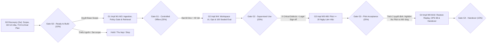

# 05 — Lộ trình 5 Release Gates, Ma trận Dual-Hat, Quy chuẩn Git/Jira & Nội quy Nhóm

> Tài liệu điều hành dự án qua `5` Cổng Phát hành (`G0–G4` trên `12` tuần), mô hình phân công **Dual-Hat** cho `10` thành viên chuẩn RFP Mục 11 (`P1–P5` & `S1–S5`), quy chuẩn Git/PR, quy trình Jira Rolling Dispatch, nội quy `R01–R10` và cơ chế kỷ luật nhóm.

---

## 1. Lộ trình 5 Release Gates (`G0–G4` trên 12 Tuần — Không gộp G3 & G4)

Khung kế hoạch tham chiếu gồm **`2` tuần Discovery (`G0`) + `10` tuần Triển khai (`G1–G4`) = `12` tuần** (mốc 10 tuần triển khai là kế hoạch tham khảo, không được phép nén thời lượng `>= 20` ngày làm việc quan sát Pilot). **Tuyệt đối không gộp Gate `G3` và `G4`**, và không hạ tiêu chí cổng để kịp tiến độ.



| Gate | Tên cổng (RFP Mục 9) | Thời điểm tham chiếu | Thanh toán (Mục 12) | Gói `WP / DEL` | Tiêu chí thoát Gate & Chặn phát hành (`Hard Blockers`) |
|---|---|---|---|---|---|
| **G0** | `Ready to Build` | Kết thúc Tuần `1–2` Discovery | **`10%`** | `WP 01`, `DEL 01`, `DEL 05`, `DEL 06` | Chốt `3` họ chính sách; `>= 4` tuần lịch sử câu hỏi (hoặc kế hoạch kéo dài quan sát) + baseline effort; duyệt mẫu `30` passages + `10` critical fields & kế hoạch biên tập phần còn lại; Authority/Date Matrix; so sánh `3` phương án có giá (`DEL 05`); quyết định Base Scope tách riêng `O1`; Eval Plan bảo đảm độc lập `S4`. |
| **G1** | `Controlled Offline` | Kết thúc Triển khai Tuần `1–3` | **`25%`** | `WP 02`, `WP 03`, một phần `DEL 02/03` | Nạp & đối soát `100%` corpus (`<= 30` tài liệu, `<= 300` đoạn, `<= 50` trường); `2` CSV validators + Quarantine + Tombstone + Late-batch (`<= 500` dòng/`<= 30` phút `OPS 01`); kiểm chứng lọc quyền, giờ VN, `CriticalField` xác định, `DAT 05` Conflict Hold; chạy `60 Dev + 40 Val`. *(Chặn nếu sai đối soát, lộ quyền hoặc dùng dữ liệu KH thật trái phép).* |
| **G2** | `Supervised Use` | Kết thúc Triển khai Tuần `4` | **`25%`** | `WP 04`, `WP 05`, hoàn tất `DEL 02`, `DEL 03` (G2) | Hoàn thiện Split-Screen Workspace (`100–250` từ, tách nguyên văn/diễn giải, `Referral`, `Feedback`); đạt `OPS 02–05` (**`p95 <= 25s`**, purge `<= 5` phút); đạt **`0` lỗi Critical Controls** và toàn bộ ngưỡng Mục 8 trên **`100 Sealed` + `80 Challenges` (`40 VN 02`)** do `S4` chấm độc lập; `P5` ký duyệt pháp lý **Phụ lục F** có ngày; xong đào tạo & fallback thủ công. |
| **G3** | `Pilot Acceptance` | Sau **`>= 20` ngày làm việc** Pilot (Triển khai Tuần `5–8` / xét đầu W9) | **`25%`** | `WP 06`, hoàn tất `DEL 03`, cập nhật `DEL 05` | Đủ `>= 20` ngày làm việc với `>= 5` non-dev representative users (kéo dài nếu nghỉ lễ/ít ca); đạt **giảm `>= 20%` mean total staff effort** so với baseline thư viện tìm kiếm đã làm sạch; `0` lỗi trọng yếu; SLA `>= 99.5%`; tuân thủ trần `1.000 pkg / 2.000 calls`. **Ra `2` quyết định tách biệt:** (1) Nghiệm thu Pilot `DEL 03` vs (2) Đầu tư mở rộng đối chiếu payback `<= 24` tháng (`Annex E`). |
| **G4** | `Handover` | Kết thúc Triển khai Tuần `9–10` | **`15%`** *(đủ `100%`)* | `WP 06`, `DEL 04`, `DEL 06` | Nếu có sửa đổi sau G3, `S4` hoàn tất RCA + independent retest; pass **`OPS 07`** Restore (`RTO 4h / RPO 24h`, chu kỳ `35` ngày) có **Replay xóa/thu hồi/quyền**; pass **`OPS 08`** cạn hạn mức & xuất định dạng mở đọc trên trình đọc trung lập; chứng nhận xóa Annex C (`> 90d` raw export); bàn giao code, schemas, config, `280` lawful fixtures & `4` bộ tài liệu vận hành. |

---

## 2. Ma trận Phân công 10 Người theo Mô hình **Dual-Hat**

Mỗi thành viên đội `10` người mang đồng thời **2 mũ phối hợp thống nhất**:
- **Mũ RFP (Trách nhiệm Bàn giao & Pháp lý — RFP Mục 11):** Quyền hạn và trách nhiệm giải trình đối với sản phẩm bàn giao (`WP`/`DEL`), cổng nghiệm thu và xử lý sự cố.
- **Mũ Thực thi / Dev (`G0–G4`):** Đầu việc cụ thể từng tuần để **không ai bị trống việc** trong suốt `12` tuần triển khai, nhưng vẫn bảo vệ nghiêm ngặt hàng rào **Chinese Wall**.

| Mã | Thành viên | Mũ RFP (Bàn giao & Trách nhiệm Mục 11) | Mũ Thực thi / Dev xuyên suốt `G0 → G4` (Không trống việc) | Ràng buộc Độc lập Bắt buộc |
|---|---|---|---|---|
| **`P1`** | **Mỹ Vân** | `Purchaser sponsor`: Chốt phạm vi (`M` vs `O1`), ngân sách, tuyến giải pháp, quyết định đầu tư `<= 24m` payback & ký `5` Gate (`10/25/25/25/15%`). | **G0:** Chủ trì thẩm định phương án & quyết định `O1`; **G1–G2:** Chủ trì hội đồng duyệt Gate & tách biệt vai trò; **G3:** Tham gia nhóm `5` người dùng đại diện Pilot `20` ngày & tách `2` quyết định G3; **G4:** Ký đóng G4. | Không chuyển trách nhiệm giải trình chính sách sang Supplier; phân biệt nghiệm thu Pilot với mở rộng. |
| **`P2`** | **Hữu Tài** | `Policy owners`: Phê duyệt `3` họ chính sách, Authority/Date Matrix, Critical Fields, ngoại lệ, chỉ định substitutes & giải quyết xung đột/referral. | **G0:** Ký ma trận thẩm quyền/ngày; **G1:** Duyệt toàn bộ corpus `300` đoạn + `50` trường & quy tắc hold; **G2:** Làm **Policy Reviewer #1** chấm nhãn `200` ca & hoàn tất đào tạo Owner; **G3:** Xử lý referral thực tế `20` ngày & rà chất lượng; **G4:** Nghiệm thu đào tạo tiếp quản. | Không tự xem code/prompt tinh chỉnh; phối hợp thêm `1` reviewer không code (`P3` hoặc `P5`). |
| **`P3`** | **Chí Kha** | `Knowledge and data steward`: Chuẩn bị `2` CSV UTF-8, tham chiếu gốc, phiên bản, quarantine, xuất bản, thu hồi khẩn & xóa `90` ngày (`Reconciliation owner`). | **G0:** Biên tập mẫu `30` đoạn + `10` trường; **G1:** Xuất đủ `300` đoạn + `50` trường chuẩn UTF-8; **G2:** Làm **Policy Reviewer #2** đồng chấm nhãn với `P2` + diễn tập Withdraw/Stale; **G3:** Vận hành batch ngày & thu hồi `20` ngày; **G4:** Kiểm chứng đọc mở `OPS 08` trên trình đọc trung lập. | Giữ quyền xuất bản/thu hồi độc lập với lịch thanh toán; không tham gia code hệ thống. |
| **`P4`** | **Trà My** | `Staff users`: Đầu mối cung cấp câu hỏi thực, kiểm tra nguồn/ngày/trích dẫn, ghi nhận hiệu chỉnh & điều phối `Five representative users`. | **G0:** Gom `>= 4` tuần câu hỏi & đo baseline effort; **G1:** Chuẩn bị `200` câu hỏi + từ điển viết tắt CRM; **G2:** Đánh giá usefulness `>= 80%` & đào tạo `5` rep users; **G3:** Ghi log effort `20` ngày làm việc (`1–20`) & phản hồi `KNW 07`; **G4:** Ký nghiệm thu đào tạo user. | Đảm bảo `5` đại diện thử nghiệm là người ngoài đội Build (`S2`, `S3`, `S5`). |
| **`P5`** | **Anh Khoa** | `Privacy and security owners` (+ `Legal/Records Owner`): Duyệt RBAC, mục đích xử lý, lưu giữ, pháp lý Phụ lục F, sự cố `4h` & điều khoản thoát. | **G0:** Thiết lập khung RBAC & lưu giữ `Annex C/F`; **G1:** Kiểm toán quyền trên direct URL, cache & log; **G2:** **Ký duyệt có ngày hồ sơ pháp lý & phân loại AI (Phụ lục F)** trước dữ liệu thật; **G3:** Giám sát PII `SEC 02` & sự cố `4h`; **G4:** Chứng kiến Restore Replay & hủy dữ liệu. | Hosting nội địa/mã hóa không thay thế chữ ký pháp lý; mọi điểm mơ hồ chuyển Legal Owner. |
| **`S1`** | **Hoàng Tiến** | `Named lead`: Đầu mối Nhà cung cấp, tổng hợp giờ công theo vai & tuần (`RFP Mục 11`), quản lý phụ thuộc hai phía, TCO `DEL 05` & bàn giao `DEL 04/06`. | **G0:** Solution Architect lập so sánh `3` phương án & TCO `3` năm VND; **G1–G2:** Điều phối Sprint, tổng hợp bằng chứng `DEL 02/03` & kế hoạch `20` ngày; **G3:** Lập báo cáo `DEL 03` + cập nhật Value Case (`Annex E`) + tham gia nhóm `5` rep users (nếu không chạm code tinh chỉnh); **G4:** Kiểm kê mã/license & tổ chức đào tạo chuyển giao `4` nhóm vai trò. | Không xem/đánh tráo `100 Sealed`; không tự ý phê duyệt chính sách thay SongNhat. |
| **`S2`** | **Quốc Hưng** | `Integration engineer`: Bàn giao `WP 02 Imports`, `DAT 01/02/08`, `OPS 01/08` và tách biệt sạch `O1`. | **G0:** Thiết kế Từ điển trường & `2` CSV schemas; **G1:** Code `ingestion`, `knowledge`, `worker/src/tasks/import_task.py`, Quarantine, Tombstone, Late-batch guard; **G2:** Code vòng đời phát hành, `feedback_candidate` queue & stale tracking; **G3:** Giám sát đối soát batch ngày `20` ngày; **G4:** Hoàn thiện công cụ Export mở `OPS 08` & bàn giao schema/ETL. | **CẤM xem `100 Sealed`**; không làm Staff user thử nghiệm; không tự bịa rule thiếu. |
| **`S3`** | **Yến Nhi** | `Retrieval and application engineer`: Bàn giao `WP 03–05`, `ANS 01–08`, `VN 01` & `OPS 02`. | **G0:** Thiết kế Deterministic UI & kiến trúc `5` tầng; **G1:** Code `policy`, `retrieval` (`pgvector + unaccent + pg_trgm`), `answer`, `validation`, `prompts/`, `worker/src/tasks/index_task.py`; **G2:** Code Split-Screen Frontend `/chat`, `/evidence`, `/referrals`, `9` Worked Cases & chống Prompt Injection; **G3:** Theo dõi `task_id` & quota `20` ngày; **G4:** Test cạn cap `OPS 08` & tài liệu build/test. | Giữ logic quyền/ngày/ngưỡng ngoài prompt; **CẤM xem `100 Sealed`** & không tự chấm điểm. |
| **`S4`** | **Quý Hải** | `Quality lead` (**Độc lập**): Bàn giao kiểm định độc lập Mục 8, `VN 02`, `DEL 03` & retest sau sửa đổi. | **G0:** Lập Eval Plan `60/40/100 + 80`; **G1:** Phân vùng `60/40/100 Sealed` & `80 Challenges (40 VN 02)`, kiểm định `OPS 01/03/04`; **G2:** Chấm độc lập `100 Sealed` & `80 Challenges` (báo riêng mẫu số, tính `Hold`); **G3:** Kiểm toán giảm `>= 20%` effort `20` ngày; **G4:** Kiểm toán Git diff sau G3, RCA, independent retest, chứng nhận `OPS 07/08` & bộ `280` lawful fixtures. | **BẤT DI BẤT DỊCH:** Không viết code sản phẩm hay tinh chỉnh hệ thống cùng `S2, S3, S5`; giữ kín `100 Sealed`. |
| **`S5`** | **Ngọc Duy** | `Operations specialist`: Bàn giao `WP 06`, `SEC 01–07`, `DEL 06`, SLA `99.5%`, Restore `OPS 07` & hỗ trợ thoát. | **G0:** Thiết kế kiến trúc vận hành, SLA & Backup/Restore; **G1:** Dựng hạ tầng tách test/prod, `identity`/RBAC, `pii_guard`, benchmark `OPS 01`; **G2:** Code `admin`/`audit`, Cost Meter, `withdraw_and_purge_cache` (`<= 300s`), `OPS 02–05` & `Emergency Disable`; **G3:** Trực SLA `08:00–17:00` (`2h/4h`), backup `35d`; **G4:** Diễn tập `OPS 07` Restore Replay & hủy dữ liệu quá `90d`. | Fail-closed khi mất trạng thái DB/quyền; **CẤM xem `100 Sealed`** & không làm Staff user. |

---

## 3. Quy chuẩn Git, Branch, Commit & Pull Request

### 3.1 Quy ước Nhánh & Commit
- **Nhánh chính được bảo vệ:** `main` (ổn định) và `develop` (tích hợp). Tuyệt đối **không code trực tiếp** trên `main` hoặc `develop`.
- **Cú pháp tên nhánh:** `<type>/<ISSUE-KEY>-<slug>` (viết thường, không dấu, ngắn gọn `4–7` từ theo Summary tiếng Anh của Jira).
  - Các `<type>` hợp lệ: `feat`, `fix`, `hotfix`, `refactor`, `docs`, `test`, `chore`, `ops`, `sec`, `gov`, `policy`, `data`, `release`.
  - Ví dụ: `feat/CRM-G1-SUB07-base-csv-validators-quarantine`, `fix/CKPA-145-citation-page`, `ops/CRM-G2-SUB07-physical-cache-cleanup-5min`.
- **Cú pháp Commit Message:** `<type>(<scope>): <mô tả ngắn> [<ISSUE-KEY>]`
  - Ví dụ: `feat(ingestion): add CSV quarantine isolation [CRM-G1-SUB07]`, `fix(retrieval): filter withdrawn passages before ranking [CKPA-45]`.
  - Tránh các message mơ hồ (`update`, `done`, `fix bug`, `final`).

### 3.2 Quy trình Staging & Checklist Trước Commit
```bash
git status --short
git branch --show-current
git diff
git add <file-thuoc-task>
git diff --staged
```
- **Lưu ý bảo vệ staging:** Không dùng `git reset HEAD`, `git restore` hoặc `git push --force` tùy tiện khi chưa kiểm tra kỹ ảnh hưởng tới thay đổi chưa commit.
- **Checklist bắt buộc trước khi commit / push:**
  - [ ] Task gắn đúng `<ISSUE-KEY>` và không lấn sang `O1` hay tính năng ngoài `Base Scope (M)`.
  - [ ] Đã chạy kiểm tra phù hợp: `.\dev.ps1 lint` & `.\dev.ps1 test` (hoặc `make lint test`).
  - [ ] Kiểm tra phân quyền `audience`, ngày hiệu lực `Asia/Ho_Chi_Minh`, trường trọng yếu xác định và hành vi Fail-Closed / Hold.
  - [ ] Tuyệt đối **không commit** `.env`, secret/API key, dữ liệu khách hàng thật, log PII hoặc bộ **`100 Sealed`**.
  - [ ] `git status --short` và `git diff --staged` chỉ chứa các tệp thuộc đúng phạm vi task.

### 3.3 Quy trình Pull Request & Code Review
- **Tiêu đề PR:** `[<ISSUE-KEY>] <Mô tả ngắn mục tiêu PR>` kèm mô tả thay đổi, cách test, bằng chứng (`pytest`/`ruff`/ảnh), rủi ro và hướng dẫn rollback.
- **Nguyên tắc Review:**
  - Reviewer tập trung vào: quyền & riêng tư (`SEC 01–02`), ngày/scope, trích dẫn nguồn gốc, critical fields, hold/fallback và test evidence.
  - Gắn nhãn **`[blocking]`** cho lỗi bắt buộc sửa trước khi merge; **`[suggestion]`** cho đề xuất cải thiện.
  - **Không tự approve PR của mình.** Không merge khi CI (`.github/workflows/ci.yml`) fail hoặc còn comment `[blocking]` chưa giải quyết.

---

## 4. Quy trình Jira & Cơ chế Rolling Dispatch

### 4.1 Cấu trúc Hierarchy & Rolling Dispatch (`1–2` Task / Người)
- **Cấu trúc Jira theo `5` Gates:** `Epic` (`CRM-G0-EP01` .. `CRM-G4-EP01`) → `Story` (`10` vai trò mỗi Gate) → `Sub-task` / `Task` / `Bug` / `Spike`.
- **Summary chuẩn:** Bắt đầu bằng động từ hành động + đối tượng (`4–7` từ tiếng Anh không dấu) để chuyển trực tiếp thành `<slug>` nhánh Git.
- **Rolling Dispatch (Phát task cuốn chiếu):**
  - Tại một thời điểm chỉ kích hoạt Sprint của **Gate hiện hành**; **không mở Gate tiếp theo** khi Gate trước chưa ký thoát cổng.
  - Mỗi thành viên chỉ giữ tối đa **`1–2` task ở trạng thái `In Progress`** cùng lúc để tránh nghẽn review và phân tán.
- **Workflow trạng thái:** `Backlog → Selected → In Progress → In Review → QA/Verification → Done` (kèm `Blocked`, `Reopened`). Chỉ chuyển `Done` khi đáp ứng `100%` Acceptance Criteria (Given/When/Then) và đủ bằng chứng bàn giao.

### 4.2 Xử lý Blocker & Mẫu Cập nhật Tiến độ
- **Timebox tự kiểm tra:** Tối đa `~30 phút` cho lỗi kỹ thuật thông thường trước khi nhờ hỗ trợ kèm thông tin tái hiện (đã khử dữ liệu nhạy cảm).
- **Báo cáo KHẨN NGAY LẬP TỨC (không chờ timebox):** Khi nghi ngờ rò rỉ dữ liệu khách hàng, bypass quyền RBAC, lộ bộ `100 Sealed`, sai ngày hiệu lực hoặc lỗi trọng yếu.
- **Mẫu Comment cập nhật / Handover chuẩn trên Jira:**
  ```markdown
  ## Progress & Handover
  - Completed / In progress / Remaining:
  - Test Evidence (lint/pytest/eval) & Branch/PR:
  - Blockers / Risks (nếu có) & Owner cần hỗ trợ:
  - Rollback / Fallback notes:
  ```

---

## 5. Nội quy Nhóm (`R01–R10`), Cơ chế Kỷ luật & Họp Bi-daily

### 5.1 Mười (10) Hành vi Vi phạm Quy định (`R01–R10`)

| Mã | Hành vi vi phạm |
|---|---|
| `R01` | Đi trễ hoặc vắng mặt không báo trước trong hoạt động/họp đã thống nhất. |
| `R02` | Không cập nhật tiến độ trên Jira / báo cáo định kỳ theo yêu cầu chung. |
| `R03` | Trễ deadline không báo nguy cơ trước hoặc không có lý do hợp lý. |
| `R04` | Nhận việc nhưng bỏ mặc, không phản hồi hoặc không bàn giao rõ ràng. |
| `R05` | Báo cáo sai sự thật hoặc cố tình che giấu tình trạng công việc / lỗi. |
| `R06` | Xúc phạm, công kích hoặc thiếu tôn trọng thành viên khác. |
| `R07` | Tự ý thay đổi cam kết chung, phạm vi hoặc deadline mà không thông báo. |
| `R08` | Cố tình không phối hợp hoặc cản trở công việc chung. |
| `R09` | Tái phạm lỗi đã được nhắc nhở và thống nhất cách khắc phục. |
| `R10` | Tiết lộ thông tin nội bộ, dữ liệu khách hàng hoặc bộ `100 Sealed` trái phép. |

### 5.2 Cơ chế Kỷ luật "Sẹo" (Leader Hoàng Tiến Phê duyệt)
Áp dụng trực tiếp cho các vi phạm `R01–R10` theo mức độ *Nhẹ → Trung bình → Nặng → Nghiêm trọng*:
- **`1` sẹo:** Trừ **`2%`** điểm đánh giá chung / kết quả thành viên.
- **`5` sẹo:** Trừ **`20%`** điểm đánh giá chung / xem xét kỷ luật nhóm và báo cáo người phụ trách.
- **Quy trình `5` bước công bằng:** (1) Ghi nhận thời gian, nội dung & bằng chứng → (2) Thông báo và tiếp nhận giải trình của thành viên → (3) Nhóm/điều phối viên xác minh → (4) Chốt mức xử lý (không phạt trùng cùng một hành vi trong cùng sự việc, có xét bất khả kháng) → (5) Ghi nhận khắc phục (không áp dụng hồi tố quy định mới).

### 5.3 Lịch họp Bi-daily Standup & Báo cáo Giờ công
- **Chu kỳ họp:** **2 ngày/lần (Bi-daily Standup)** bắt buộc đúng giờ, ngắn gọn trọng tâm theo bộ `4+1` câu hỏi:
  1. *What did you do?* (Đã hoàn thành gì kèm link PR/Jira?)
  2. *What are you doing?* (Đang làm `1–2` task nào?)
  3. *What will you do next?* (Bước tiếp theo tới buổi họp sau?)
  4. *Do you need help?* (Có blocker hay phụ thuộc `P ↔ S` cần gỡ?)
  5. *Any questions?* (Điểm cần làm rõ về phạm vi/quyền/chính sách?)
- **Báo cáo giờ công hàng tuần:** Theo RFP Mục 11, mọi thành viên ghi nhận đủ giờ công thực tế theo vai trò & tuần để **`S1` Hoàng Tiến** tổng hợp nộp đối soát cùng tiến độ `5` Release Gates.
